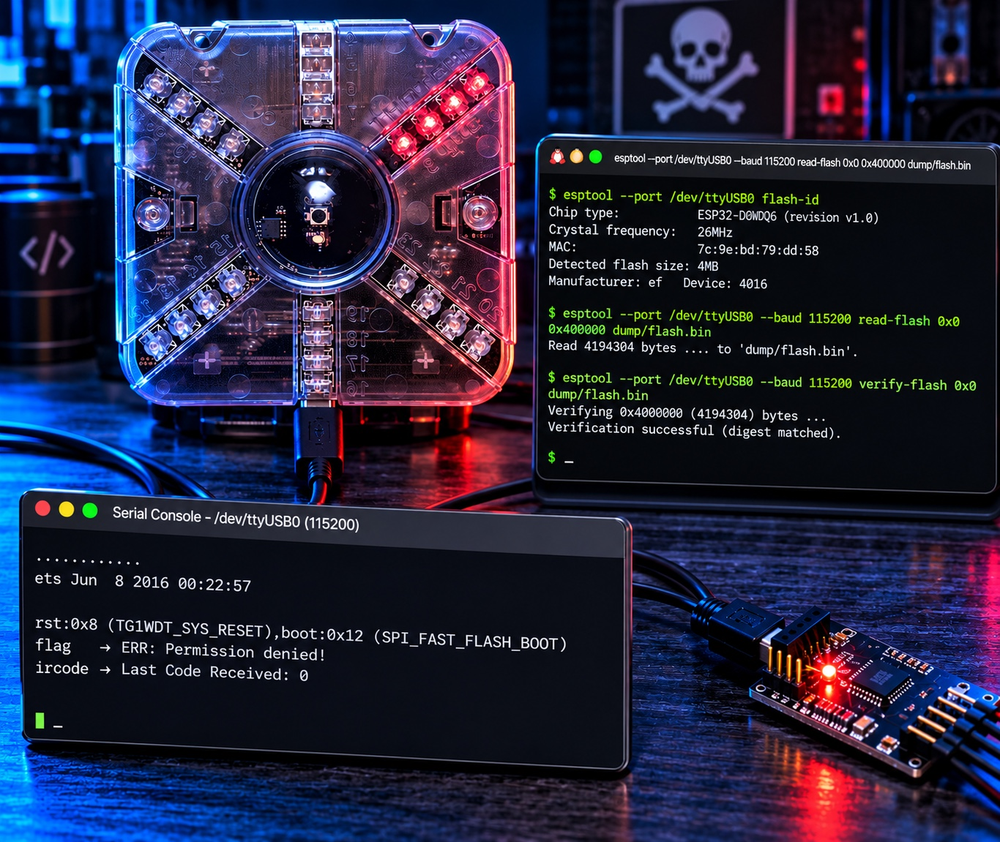

# Three Flags, One Decoy, and an ESP32: Reverse Engineering a Thotcon 0xC Badge

*I dumped a conference badge's flash, decompiled its Xtensa firmware, stood up a fake conference Wi-Fi network to talk to it, and found that its headline `flag` command was built to lie to me.*

---



A friend handed me a Thotcon 0xC badge and the challenge that comes with every good conference badge: find the flags. I had no documentation, no source, and no idea what was on the board beyond a USB-serial cable that enumerated as `/dev/ttyUSB0`. This is the full account of taking it apart in software, from the first passive listen on the serial line to a complete map of every subsystem: the UART console, a capacitive-touch game, a Wi-Fi/IRC client, and an infrared combat system. I pulled three flags, and the most interesting one came from a command that is engineered never to give it to you. The scripts I built along the way are in this repo.

## TL;DR

The badge is an **ESP32-D0WDQ6** (dual-core Xtensa LX6, 4 MB flash) running an Arduino-ESP32 firmware. The honest way in is the boring, correct one: identify the chip from its boot banner, dump the flash read-only with `esptool`, verify the dump byte-for-byte, then do every bit of analysis offline on the copy. The one surprise that matters: the badge's `flag` command is a decoy. Typing `flag` always returns `ERR: Permission denied!`, and no developer mode, IR code, or network trick changes that. The real flag is assembled at runtime inside a handler the dispatcher is hardcoded never to call, so the only way to read it is to decompile the Xtensa code.

| Flag | Where it lives | How to get it |
|---|---|---|
| `flag{welcome_to_the_8bit_world}` | UART boot banner | Read the serial console at boot |
| `flag{lets_fight!}` | Touch buttons | Enter the Konami code: `Up Up Down Down Left Right Left Right Select` |
| `flag{byte_fu}` | The `flag` command's dead-code handler | Decompile it; the command itself always refuses |

This writeup is both the story (including the detours, because the detours are where the real knowledge is) and a runbook. The scripts and the full findings are at the end.

---

## The setup

- **Host:** Linux workstation, CLI-first, `rizin` and Python available.
- **Target:** Thotcon 0xC badge. ESP32-D0WDQ6 rev v1.0, 26 MHz crystal, 4 MB Winbond W25Q32 flash (`ef:4016`), MAC `7c:9e:bd:79:dd:58`. FTDI FT231X USB-UART bridge (`0403:6015`) on `/dev/ttyUSB0`.
- **Goal:** Find every flag, and understand every subsystem well enough to explain how it works.
- **Constraints:** Read-only on the hardware until I have a verified dump. Reproducible commands. No guessing where the firmware can answer.

Conference badges are a near-perfect reverse-engineering target: small enough to fully understand, deliberately seeded with puzzles, and built by people who expect you to try. The only rule I set myself was the one that matters on any device you want to keep working: never write to it before I have a dump I can trust.

---

## Act 1: It shows up as ttyUSB0 (passive recon)

Before sending a single byte, I asked the kernel what it had already learned.

```bash
udevadm info -q property -n /dev/ttyUSB0 | grep -E 'ID_(VENDOR|MODEL|SERIAL)'
```
```
ID_MODEL=FT231X_USB_UART
ID_VENDOR_ID=0403
ID_MODEL_ID=6015
```

An FTDI FT231X. That tells me there's a separate USB-to-UART bridge and the real MCU is behind it. Next I listened. Many embedded devices chatter on their own, and that chatter is free intelligence.

```bash
python3 -c "
import serial,time
s=serial.Serial('/dev/ttyUSB0',115200,timeout=0.2)
buf=b''; end=time.time()+5
while time.time()<end: buf+=s.read(4096)
print(repr(buf[:80]))"
```
```
b'..........'
```

A `.` roughly every half-second: a heartbeat. 115200 was clearly right (clean ASCII, regular timing). So the firmware is alive and idle-printing. Now the question was how to make it talk back. I sent a carriage return, got nothing, and sent `help` terminated with `\r`, still nothing. Then I sent a bare newline, and the badge answered in a way I did not expect:

```
ets Jun  8 2016 00:22:57
rst:0x8 (TG1WDT_SYS_RESET),boot:0x12 (SPI_FAST_FLASH_BOOT)
...
```

That is the ESP32 boot ROM. My malformed input had tripped a watchdog and rebooted the chip, and the reboot told me two things at once: the MCU is an **ESP32**, and the console processes commands on `\n`, not `\r`. The `\r` I had been sending was being ignored.

**Lesson #1:** Listen before you speak, and read the accidents. I learned the chip family and the line terminator from output the device produced on its own and from a crash I caused by mistake, before I had any idea what I was looking at. On an unknown target, idle heartbeats, boot banners, and self-inflicted resets are the cheapest reconnaissance you will ever get.

---

## Act 2: Fingerprint and dump (read-only, then verify)

With `\n` as the terminator, the console came to life, but first I wanted the chip's full identity and a copy of its flash. `esptool` speaks the ESP32 download protocol over the same UART, and the FT231X's DTR/RTS lines are wired to the chip's reset and boot pins, so it can enter download mode on its own.

```bash
esptool --port /dev/ttyUSB0 flash-id
```
```
Chip type:          ESP32-D0WDQ6 (revision v1.0)
Crystal frequency:  26MHz
MAC:                7c:9e:bd:79:dd:58
Detected flash size: 4MB
Manufacturer: ef   Device: 4016
```

A 26 MHz crystal, which is slightly unusual (most ESP32 boards use 40 MHz) and explains something I had glossed over: the very first boot-ROM banner looked garbled at 115200. The ROM computes its own UART divisor assuming a 40 MHz crystal, so on a 26 MHz board the ROM's own prints come out at the wrong baud. The application's `Serial` output is clean because the app sets the baud correctly.

Dumping came with one speed lesson. At 460800 the read corrupted partway through:

```
ERROR: A fatal error occurred: Corrupt data, expected 0x1000 bytes but received 0xf03 bytes.
```

That is the classic symptom of a USB-UART link that cannot keep up. I dropped to 115200, which is slow (about seven minutes for 4 MB) but solid, and then proved the copy was perfect before trusting it.

```bash
esptool --port /dev/ttyUSB0 --baud 115200 read-flash 0x0 0x400000 dump/flash.bin
esptool --port /dev/ttyUSB0 --baud 115200 verify-flash 0x0 dump/flash.bin
```
```
Read 4194304 bytes ... to 'dump/flash.bin'.
Verifying 0x400000 (4194304) bytes ... Verification successful (digest matched).
```

`verify-flash` re-reads the chip and compares it to my file; it does not write anything. A match (md5 `267eeb22b7347d95c12803129fae9637`) meant I could put the badge down and do everything else offline.

**Lesson #2:** A dump you have not verified is a liability, not an asset. The faster read that silently drops bytes is worse than the slow one that finishes, because you will build hours of analysis on top of a hole you do not know is there. Read slow, verify, then never touch the hardware again until you have a reason.

---

## Act 3: Carve and triage

My first instinct on any firmware blob is `binwalk`, which scans for known signatures and labels what it finds. On this image it came back thin:

```
DECIMAL     HEXADECIMAL   DESCRIPTION
4196        0x1064        Unix path: .../esp32-arduino-lib-builder/.../bootloader_init.
4464        0x1170        Unix path: .../esp32-arduino-lib-builder/.../bootloader_random
110027      0x1ADCB       Neighborly text, "neighbor entry"
139096      0x21F58       SHA256 hash constants, little endian
1420631     0x15AD57      Neighborly text, "neighbor entry"
1449704     0x161EE8      SHA256 hash constants, little endian
```

Six hits, and not one is a partition table or an app header. That is a limitation worth understanding, not a binwalk failure: it only recognizes formats in its signature database, and ESP32's app-image and partition-table layouts are not in it. So on ESP32 it finds generic things: two build-machine path strings compiled into the bootloader, the 64 round constants that every SHA-256 implementation contains, and a couple of false-positive text matches. Its silence on the real structure is the signal to switch methods.

But the hits are still worth aligning, and "aligning" is just placing each offset in the partition it falls in. Do that and a pattern appears:

| binwalk offset | Lands in | What it is |
|---|---|---|
| 0x1064, 0x1170 | bootloader | build path strings |
| 0x1ADCB, 0x21F58 | app0 | false positive, SHA-256 constants |
| 0x15AD57, 0x161EE8 | app1 | the same two, again |

The app0 hits reappear in app1, about `0x140000` later:

```
0x15AD57 - 0x1ADCB = 0x13FF8C   (~0x140000)
0x161EE8 - 0x21F58 = 0x13FF90   (~0x140000)
```

`0x140000` is the app-slot size, so binwalk's duplicated hits are quietly telling me the firmware sits in two OTA slots, without ever labeling a partition. The mirror is not exact, though, and the two slots have different checksums:

```
ad92287902e91431836a8a912ce528c4  app0.bin
ec3dc8270caf2d29c4687990c15c8a55  app1.bin
```

So they are sibling builds, near-identical but not byte-for-byte. That nuance came from aligning and comparing, not from any label binwalk printed.

**Lesson #3:** binwalk aligns the image to what its database already knows; your job is to align its hits to the map you build yourself. Where it is silent, the offsets it does report still carry structure: a signature that repeats at a fixed stride is duplicated content, and the stride is the size of the thing being duplicated.

To get the real layout I went to the source of truth. Once the chip is identified as ESP32, its flash layout is a documented convention: the partition table sits at a fixed offset `0x8000`, and each 32-byte entry starts with the magic `0xAA 0x50`. If I had not known that, I could find it the way binwalk does but with the right signature: search the whole image for `0xAA50` and look for a regular stride.

```bash
python3 -c "
d=open('dump/flash.bin','rb').read(); i=0
while True:
    i=d.find(b'\xaa\x50',i)
    if i<0: break
    print('0x%06x'%i); i+=2"
```
```
0x001714
0x008000
0x008020
0x008040
0x008060
0x008080
...
```

Five hits at `0x8000`, each exactly `0x20` (32) bytes apart: that regular stride is the partition table announcing itself. The lone hit at `0x1714` is a coincidental byte pair in code, not an entry, because it stands alone. Parsing those entries gave the map:

| Label | Type | Offset | Size | Notes |
|---|---|---|---|---|
| nvs | nvs | 0x9000 | 20 KB | settings |
| otadata | data | 0xe000 | 8 KB | selects active app (app0) |
| app0 | ota_0 | 0x10000 | 1280 KB | the image I analyzed |
| app1 | ota_1 | 0x150000 | 1280 KB | second OTA slot (sibling build) |
| spiffs | spiffs | 0x290000 | 1472 KB | 100% erased (all `0xFF`) |

The SPIFFS filesystem was completely empty, which told me every asset, string, and secret lives in the code, not in a filesystem I could just read out. The app image's descriptor identified it as an Arduino-ESP32 build on ESP-IDF v4.4.4 from April 2023. Then the fastest possible content check, `strings`, immediately paid off:

```bash
strings -n 4 dump/parts/app0.bin | grep -oE 'flag\{[^}]*\}' | sort -u
```
```
flag{lets_fight!}
flag{welcome_to_the_8bit_world}
```

Two flags in plaintext. But the same scan also turned up a bare `flag{` prefix with no closing brace near it, and the strings `byte_fu`, `Developer Mode:`, and `ERR: Permission denied!`. A lone `flag{` with no body is a tell: at least one flag is **assembled at runtime** from pieces, which means it is a decompilation target, not a thing `grep` will ever find.

**Lesson #4:** `strings` is triage, not an answer. A flag prefix with no flag after it is the firmware telling you where to point the disassembler. The absence of a complete string is itself a finding.

---

## Act 4: The flag command that always lies

Driving the live console, the `help` command handed me something generous: the entire command table, including each handler's address in memory.

```
cmd: flag   - desc: print flag        - cb: 0x400D3450 - hidden: 1
cmd: ircode - desc: print last IR code - cb: 0x400D3434 - hidden: 1
...
```
```
flag   → ERR: Permission denied!
ircode → Last Code Received: 0
```

So `flag` refuses. My first theory was a developer-mode gate, but the boot banner literally prints `Developer Mode: 1`, and `test` and `ircode` are also marked `hidden: 1` yet run fine. Hidden was not the gate. The answer had to be in the code.

The ESP32 is Xtensa LX6, which Ghidra's raw loader would not take, so I used `rizin`, which has an Xtensa plugin. The app image is not an ELF, so I mapped each segment at its real load address in a small reusable script, which lets pointer loads resolve to the strings they reference:

```
om 3 0x400d0020 0x9034c 0x030020 rx seg_code
om 3 0x3f400020 0x20454 0x20     r  seg_rodata
e asm.arch=xtensa
e asm.cpu=esp32
```

Decompiling the `flag` handler at `0x400d3450` showed it building a `std::string` out of three pieces, `"flag{"`, `"byte_fu"`, and `"}"`, with no obfuscation and no condition. It just constructs `flag{byte_fu}` and returns it. That is the whole handler. Which raised the real question: if the handler unconditionally builds the flag, why does typing `flag` return a permission error?

Because the dispatcher never calls it. In the command-match loop, after confirming the typed word matches a registered command, there is a second, hardcoded comparison against the literal string `"flag"`:

```
0x400d38e9  beqz a10, . +0xd0   → 0x400d39b9   "ERR: Permission denied!"
```

`a10` there is the result of comparing your input against the constant `"flag"`. Any command whose name is exactly `flag` is routed straight to the deny block before its handler can run. The `flag{byte_fu}` builder is dead code at runtime; its only reference in the whole binary is the command table, and the one path that would reach it is intercepted. No developer mode, no IR code, no network event changes this. The command is a troll, and the author left a hint in the flag itself: byte-fu, the thing you need to read it.

**Lesson #5:** The obvious interface is sometimes a trap, and the only way to know is to read both sides. The handler and the dispatcher told two different stories; the truth was in how they connected. If I had trusted the prompt, or only read the handler, I would have concluded either that the flag was unreachable or that it was free. It was neither: it was reachable only by reverse engineering, which is the entire point.

---

## Act 5: The Konami code in the touch pads

`flag{lets_fight!}` was already in plaintext, next to the string `Hadouken!` and, a few bytes further, the button names `Down`, `Left`, `Up`, `Right`, `Select`. Right before the flag string sat a 9-byte array:

```bash
rizin ... -c "px 16 @ 0x3f401f5c" dump/parts/app0.bin
```
```
0x3f401f5c  02 02 00 00 01 03 01 03 04   ...
```

The button table nearby defined each button's index: `Down=0, Left=1, Up=2, Right=3, Select=4`. Decoding the array with that mapping gives `Up Up Down Down Left Right Left Right Select`: the Konami code. The comparator at `0x400d5478` confirmed it, looping exactly nine times over a circular buffer of the last nine presses and printing the flag on a match. So `flag{lets_fight!}` is a physical easter egg: enter the Konami code on the capacitive pads (Up is GPIO15, Down is GPIO12, Left is GPIO2, Right is GPIO13, Select is GPIO14) and the badge prints it.

**Lesson #6:** A fixed array in read-only data next to a reward string, plus a loop that reads your input against it, is the shape of a secret combo. Once you recognize the pattern you stop decompiling and start decoding: find the array, find the index mapping the firmware uses, and translate.

---

## Act 6: Faking the conference network

The badge has a Wi-Fi client it calls BadgeNET. From the firmware I reversed the whole protocol: it joins an open access point named `THOTCON-Open`, connects over IRC to a host named `TC0xCBADGE` on port 6667, and auto-joins two channels with keys, `#snowfield` (key `RAR`) and `#battles` (key `CONTRA`). It then behaves as a chat-bot, scanning incoming messages for commands like `!firmware`, `!boot`, and `!update`. None of that infrastructure exists anymore, so the feature looks dead. I decided to bring it back to life by pretending to be the conference.

I stood up an open AP named `THOTCON-Open` on a USB Wi-Fi dongle using NetworkManager's shared mode, pointed the badge's hardcoded hostname at my machine with a dnsmasq override (`address=/TC0xCBADGE/10.42.0.1`), and wrote a small IRC server that implements just enough of the protocol for the badge to register and join, logging everything it says. The badge took the bait:

```
Connecting to THOTCON-Open
WiFi connected
IP address: 10.42.0.27
BadgeBattles Soldier TC58DD79 locked and loaded
Attempting BadgeNET connection
```

It associated, pulled an IP, resolved my fake server, and tried to connect. Then it hit a wall I did not expect, and the wall was physics.

```
Connecting to THOTCON-Open
.
Brownout detector was triggered
ets Jun  8 2016 00:22:57
rst:0xc (SW_CPU_RESET)
```

The ESP32's Wi-Fi radio pulls 300 to 500 mA in bursts, and the FT231X's USB port could not supply it. Every time the radio powered up, the badge browned out and reset. It would occasionally get far enough to grab an IP on a second boot, but it could never hold the TCP session long enough to finish the IRC handshake. I confirmed the server itself was reachable and that a host firewall (`ufw`) had also been silently dropping port 6667, fixed that, and the remaining blocker was purely power.

**Lesson #7:** When a networked embedded device flaps, suspect power before protocol. I spent real effort confirming DNS, the firewall, and the server were correct, and all three were. The actual fault was that a Wi-Fi radio and a bus-powered USB-UART bridge are a bad match. This is not fixable in software: it needs a powered USB hub or external supply to the badge, with USB carrying only serial. The emulation stack was right; the amps were not there.

---

## Act 7: IR lock-on and a bucket that no longer exists

Two subsystems remained. The first was the infrared "Lock-On." I had hoped a specific IR code might unlock the `flag` command, but the firmware was clear: the IR path is laser-tag combat, nothing more. The receive task decodes a 32-bit NEC frame, validates its checksum, and on a valid frame counts exactly one point of damage, reporting `received 1 damage from TC...` to the `#battles` channel. Every valid code is worth one damage; there is no magic value and no IR-gated flag. Badges shoot each other with IR and tally the hits over IRC.

The second was the OTA updater behind the `!update` command, which pulls firmware over HTTPS from an Amazon S3 bucket. I checked whether that bucket still existed:

```bash
curl -s "https://tc0xb.s3.us-east-2.amazonaws.com/"
```
```
<Error><Code>NoSuchBucket</Code><Message>The specified bucket does not exist</Message></Error>
```

The bucket is gone, decommissioned after the conference. Worth noting for anyone with one of these badges on a live network: the bucket name is now unclaimed, which is a latent supply-chain takeover vector. A third party who registered `tc0xb` in `us-east-2` could serve firmware to any badge that runs `!update` and trusts the response. I did not act on that; registering someone else's namespace on live AWS is not mine to do. But it is the kind of finding that outlives the event.

**Lesson #8:** Reverse engineering an abandoned device surfaces security debt that nobody is maintaining anymore. A hardcoded update endpoint is fine while the vendor owns it and a liability forever after they let it lapse. The firmware does not know the difference; it will trust whatever answers at that name.

---

## The architecture

```
   Badge (ESP32-D0WDQ6, 4MB flash)
   +---------------------------------------------------+
   |  UART CLI        touch game       IR (NEC)         |
   |  8 commands      Konami combo     laser-tag        |
   |  flag=decoy      flag{lets_fight} combat, no flag  |
   |                                                    |
   |  BadgeNET: Wi-Fi client -> IRC TC0xCBADGE:6667     |
   |            #snowfield(RAR)  #battles(CONTRA)       |
   |            !update -> S3 bucket tc0xb (now gone)   |
   +---------------------------------------------------+
         |  FT231X USB-UART (/dev/ttyUSB0)
         v
   Workstation
   +---------------------------------------------------+
   |  esptool  -> dump + verify 4MB flash              |
   |  rizin    -> map segments, decompile Xtensa       |
   |  fake AP  -> THOTCON-Open + dnsmasq(TC0xCBADGE)    |
   |  IRC srv  -> badgenet_server.py on :6667          |
   +---------------------------------------------------+
```

---

## The gotchas that cost me time (collected)

**The console ignores `\r`.** Symptom: `help\r` produces nothing, so the device looks dead or the baud looks wrong. Cause: the firmware's line reader only acts on `\n`. Fix: send `\n` (or test all three terminators early). On an unknown console, the wrong line ending is indistinguishable from a broken connection.

**The boot banner looks like garbage.** Symptom: the first lines after reset are unreadable at 115200, then clean text follows. Cause: a 26 MHz crystal, where the ESP32 ROM mis-sets its own UART baud assuming 40 MHz; the application fixes it. Fix: ignore the ROM garble and read the application output, or match the ROM's actual baud if you need those lines.

**Fast flash reads corrupt on a flaky link.** Symptom: `Corrupt data, expected 0x1000 bytes but received 0xf03`. Cause: the USB-UART link cannot sustain 460800 for a long read. Fix: drop to 115200 and verify. Slower and complete beats fast and holed.

**The AP works but the badge never connects.** Symptom: the badge gets a DHCP lease but your server sees nothing. Cause, in my case, two stacked: the host firewall (`ufw`) dropped the service port, and underneath that, Wi-Fi brownouts reset the badge mid-handshake. Fix: open the port on the AP interface, then fix power. Check the firewall before you blame the firmware.

---

## The scripts

The repo includes the tooling I built, each piece shaped by a lesson above.

```
tools/
  baudscan.py          passive baud discovery (optionally resets to catch a banner)
  serial_console.py    console driver: filters the heartbeat, tries line terminators
  badgenet_server.py   minimal IRC server that the badge will register and join against
analysis/
  map.rz               rizin segment map (load addresses) reused for every disassembly
```

The console driver exists because of a bug I wrote first: a naive "read until quiet" loop never sees quiet when the device emits a heartbeat every half-second, so it hangs forever. The fix is to treat only non-heartbeat bytes as activity worth waiting on, and to cap the total wait. That one correction is the difference between a tool that works on badges and one that hangs on them, so it is baked in.

I also turned the whole process into a reusable, architecture-agnostic reverse-engineering skill, because the next badge will have a different chip and different commands, and the method generalizes even when the specifics do not.

---

## Would I recommend it?

If you have a conference badge and a free weekend, yes, without reservation. It is one of the best ways to practice end-to-end reverse engineering on something bounded and intentional.

**Good at:** teaching the full loop. Interface identification, safe firmware extraction, static decompilation, dynamic interaction, and protocol emulation, all on one small device where you can actually finish and understand everything.

**Bad at:** cooperating on bus power. Anything that lights up the radio needs a real supply, and the badge will reset in your face until you give it one.

The lesson that outlived the badge is the one from the `flag` command. The most interesting secret on a device is often not behind the control that claims to guard it. It is in the gap between what a component does and whether anything ever calls it. The prompt said no; the silicon said `flag{byte_fu}`. On any sufficiently interesting target, trust the silicon.

---

*Build notes, scripts, and the full findings report are in the companion repo: [github.com/tim-salvador/reversing-the-thotcon-0xc-badge](https://github.com/tim-salvador/reversing-the-thotcon-0xc-badge). Questions or corrections welcome.*

*Tim Salvador · [timsalvador.com/blog/reversing-the-thotcon-0xc-badge](https://www.timsalvador.com/blog/reversing-the-thotcon-0xc-badge/) · [github.com/tim-salvador](https://github.com/tim-salvador) · [linkedin.com/in/tim-salvador](https://linkedin.com/in/tim-salvador)*
