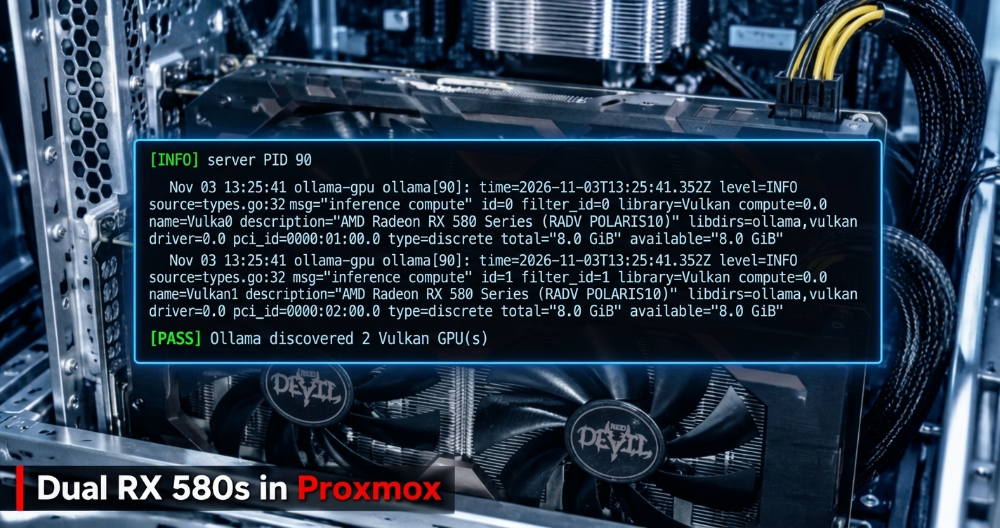

# Two $60 GPUs, One Hypervisor: Running Local LLMs and hashcat on Proxmox with AMD Polaris

*How I got a pair of Radeon RX 580s doing useful work inside Proxmox LXCs: Ollama over Vulkan, hashcat over Rusticl, Home Assistant on top, and every dead end in between.*

---



I run a homelab on a single Proxmox box: a dozen-plus LXCs and VMs doing DNS, databases, a reverse proxy, a security lab, Home Assistant, and a couple of Ollama servers. The Ollama instances were stuck on CPU, which is fine for tiny models but painful for anything else. Since I had two Radeon RX 580s in the machine already that were doing nothing useful, I figured I'd put them to work. Initially I planned to use both within a single container to GPU-accelerate my local LLMs, but later thought why not share the wealth and opted to add GPU password cracking in a second container. Two containers both sharing the same two cards seemed logical based on the use case and the frequency I would need to use each. This is the full account of getting there, including the months-old failed attempts I had to clean up first, the vendor I briefly thought I owned, and the handful of things that broke along the way. The working scripts are in this repo.

## TL;DR

I had two PowerColor RX 580 8GB cards (Polaris, gfx803) sitting in a Proxmox host and wanted them running local LLMs and password cracking, each inside its own unprivileged LXC. The "obvious" path (ROCm) is a dead end on these cards: AMD dropped Polaris from ROCm years ago. The path that actually works in 2026 is **Mesa**: RADV (Vulkan) for Ollama, Rusticl (OpenCL) for hashcat, both reaching the GPUs through plain `/dev/dri` render-node passthrough. No proprietary driver, no DKMS, no kernel coupling.

Final numbers on the pair:

| Workload | Result |
|---|---|
| Ollama, llama3.2:3b | ~61 tok/s (single card) |
| Ollama, llama3.1:8b | ~29 tok/s (single card) |
| Ollama, qwen2.5:14b | ~7 tok/s (split across both cards, 16GB) |
| hashcat MD5 | 8,123 MH/s (both cards) |
| hashcat NTLM | 3,301 MH/s |
| hashcat SHA1 | 3,801 MH/s |
| hashcat WPA2 | 293 kH/s |
| hashcat bcrypt | 19,043 H/s |

For reference, the host CPU (i7-4790K) does 91 MH/s MD5. The GPUs are ~89x faster on fast unsalted hashes.

This writeup is both the story (including the detours, because the detours are where the real knowledge is) and a runbook. The scripts I wrote to configure and validate the whole thing are at the end.

---

## The setup

- **Host:** Proxmox VE 9.2, Debian 13 (trixie) base, kernel 7.0.x-pve
- **GPUs:** 2x PowerColor Radeon RX 580 8GB (`1002:67df`, Ellesmere / Polaris10 / gfx803)
- **Goal:** GPU-accelerated Ollama in one LXC, GPU hashcat in another, sharing the two cards; everything unprivileged
- **Constraints:** homelab hardware, CLI-first, reproducible, nothing hand-wired that I can't rebuild from a script

The RX 580 is an interesting card to do this on in 2026. It's old enough that the vendor compute stack abandoned it, cheap enough on the used market to be worth a second look, and still has 8GB of VRAM, which is the thing that actually matters for fitting models.

---

## Act 1: The ROCm dead end (the first attempt, months ago)

My first run at this, a while back, went straight for the "real" GPU-compute stack: ROCm. That's what you reach for if you want PyTorch, HIP, or the officially-blessed Ollama ROCm build. So I ran `amdgpu-install`, pulled in the ROCm userspace, and started wiring it up. When the first version didn't work I tried others, because various forums claimed this or that release was the one that ran on Polaris. None of them did.

It never worked, and it was never going to. **ROCm officially dropped GCN4/Polaris support in the 5.x series.** The RX 580 is gfx803, and the ROCm runtime simply doesn't target it anymore. You can install the packages, and yes `rocminfo` even enumerated at times, but the compute path for an actual model hit a wall. I burned real time on it before accepting that.

What that first attempt left behind, which mattered a lot the second time around:

- `amdgpu-install` and ~12 ROCm/HIP packages (`hipcc`, `libamdhip64`, `rocm-device-libs`, `miopen-hip`, etc.) installed on the **host**.
- Three `repo.radeon.com` apt sources (Ubuntu jammy repos on a Debian host).
- A broken **AMDVLK** Vulkan ICD at `/opt/amdgpu/.../amdvlk64.so` that failed `vkCreateInstance`.
- `/etc/ld.so.conf.d/20-amdgpu.conf` pointing the linker at `/opt/amdgpu` libs that would shadow Debian's own.
- A 14GB `/opt/rocm-6.4.0` tree doing nothing.

I walked away from it half-finished. That turned out to be a landmine I'd step on later.

**Lesson #1:** Before you trust a vendor's "supported GPU" matrix, check whether your specific silicon is still in it. "AMD GPU" is not a capability. gfx803 vs gfx900 vs gfx1100 are different worlds for compute support. The marketing name (RX 580) tells you nothing; the ISA (gfx803) tells you everything.

---

## Act 2: Coming back to it, and a false start on the wrong vendor

Fresh eyes, second attempt. I actually started this round convinced I was setting up **NVIDIA** cards. I built an entire NVIDIA Container Toolkit runbook (driver install, DKMS, the LXC NVIDIA hook, CUDA validation) and ran the preflight against the host.

The preflight's first real check killed that immediately:

```
== GPU hardware / binding ==
[FAIL] no NVIDIA VGA/3D controller visible to lspci
```

No `10de` vendor ID anywhere on the PCI bus. What *was* there:

```
01:00.0 VGA: [1002:67df] AMD Ellesmere [Radeon RX 580]
02:00.0 VGA: [1002:67df] AMD Ellesmere [Radeon RX 580]
```

Two AMD cards, not NVIDIA. I'd been building the wrong stack entirely. The lesson here is almost too obvious, but it's the reason my preflight script leads with hardware enumeration before anything else:

**Lesson #2:** Verify the hardware before you write a line of config. The whole plan assumed a fact (NVIDIA) that `lspci -nn` would have falsified in two seconds. A good preflight is read-only and runs first precisely so you find out you're wrong *before* you've installed anything.

So I threw out the NVIDIA bundle and started over, this time for what was actually in the box.

---

## Act 3: The path that works (Mesa, not ROCm)

With ROCm off the table for Polaris, the question becomes: how do you get *compute* out of these cards without the vendor stack? The answer is Mesa, the open-source driver, which has two compute front-ends that both work on Polaris:

- **RADV** → Vulkan. Ollama ships a Vulkan backend (`libggml-vulkan.so`) and, in current versions, enables it by default. This is the Ollama path.
- **Rusticl** → OpenCL. hashcat's real backend is OpenCL. Rusticl is Mesa's modern OpenCL implementation, and it enumerates Polaris. This is the hashcat path.

Both ride on the in-tree `amdgpu` kernel driver that Proxmox already ships. That last point is the quiet hero of this whole build: **because `amdgpu` is in-tree, there's no DKMS, no driver-vs-kernel version dance, and kernel upgrades don't break the GPU path.** Compare that to the NVIDIA runbook I'd just thrown away, which was *all* about managing exactly that fragility.

### The architecture

```
┌─────────────────────────────────────────────┐
│ Proxmox host (in-tree amdgpu driver)         │
│   /dev/dri/renderD128  → card 0 (01:00.0)    │
│   /dev/dri/renderD129  → card 1 (02:00.0)    │
└───────────────┬──────────────────┬───────────┘
                │ render-node       │ render-node
                │ passthrough       │ passthrough
        ┌───────▼────────┐  ┌──────▼─────────┐
        │ CT 120 (Ollama)│  │ CT 126 (Kali)  │
        │ Mesa RADV      │  │ Mesa Rusticl   │
        │ Vulkan backend │  │ OpenCL backend │
        │ → both cards   │  │ → both cards   │
        └────────────────┘  └────────────────┘
```

Both containers are unprivileged. Both get the GPUs through Proxmox-native `devN:` device passthrough of the render nodes, owned by the container's own `render` group. No `/dev/kfd` (it's irrelevant here as that's the ROCm compute node), no whole-`/dev/dri` bind mounts, no raw `lxc.*` cgroup hacks. Render nodes are shareable, so both containers can use the same cards concurrently; VRAM is the only contended resource.

---

## Act 4: Cleaning up the past (the ROCm landmine detonates)

Before the new approach could work, the wreckage from Act 1 had to go, and it fought back.

The host still had the ROCm/AMDVLK mess. The broken AMDVLK ICD was the first visible symptom, every `vulkaninfo` emitted:

```
WARNING: vkCreateInstance returned -3 from amdvlk64.so. Skipping this driver.
```

RADV still worked (it enumerated both cards fine), but AMDVLK was noise at best and a shadowing risk at worst. I wrote a cleanup script that:

- Purged the ~12 ROCm/HIP host packages (and the AMDVLK ICD owner).
- Disabled the three `repo.radeon.com` apt sources.
- Guarded against disaster: it simulates the purge first and **aborts if any `proxmox*`/`pve*`/`lxc*`/`qemu*` package would be removed**, and it never runs `apt autoremove` (that list included my fallback kernels).

That last guard earned its keep. The ROCm packages had pulled in dev libraries (OpenCV, VTK, OpenMPI) as dependencies, and a naive `apt autoremove` would have also taken my 6.8.x fallback kernels with it.

Then the same mess showed up a second time, *inside the container*. When I ran the Ollama install script in CT 120, it died at `apt-get update`:

```
Err: https://repo.radeon.com/rocm/apt/5.7.3 jammy InRelease
  Signing key ... SHA1 is not considered secure since 2026-02-01
E: The repository ... is not signed.
```

The container had its own leftover ROCm apt sources from the old attempt, and their signing key uses a SHA1 binding that Debian's verifier now rejects outright (as of Feb 2026). On top of that, the container had `/etc/ld.so.conf.d/20-amdgpu.conf` making the linker prefer `/opt/amdgpu`'s Ubuntu-built `libdrm_amdgpu` over Debian's. The tell was subtle but definitive: the host reported the GPU as `AMD Radeon RX 580 Series`, the container as `Radeon RX 580 Series` (no "AMD" prefix). Different `libdrm`, different name table. A Ubuntu library answering underneath Debian's Mesa is an untested pairing waiting to break.

**Lesson #3:** A failed install isn't a no-op. It leaves apt sources, ld.so paths, ICD files, and 14GB of dead weight that will actively sabotage your *next* approach, sometimes silently (library shadowing), sometimes loudly (apt refusing a stale key). The scripts I ended up writing don't just install; they detect and refuse to proceed on known leftovers, with clear messages pointing at the fix. That's the difference between a script and a runbook.

---

## Act 5: It works

With the host and container cleaned, the real install went through. The validation script runs a real inference workload, not just the `nvidia-smi` style "does it enumerate". So here's what passed:

- Both render nodes map to live PCI addresses, owned by the container's `render` group.
- `vulkaninfo` lists both RX 580s as RADV devices, **both as root and as the `ollama` service user** (that second check is the one that proves the service account's group permissions, not just root's).
- Ollama's log shows two Vulkan devices discovered, `type=discrete`, PCI IDs matching the host.
- A real inference run: `ollama ps` shows `100% GPU`, and host-side `gpu_busy_percent` peaks at 100% with VRAM climbing on the card during generation. (I sample the host sysfs *during* the benchmark to prove the work is actually on the GPU, not just claimed to be.)

A 3B model loads on one card (~2.5GB VRAM). A 14B model splits across both (16GB total), which the validation confirms by watching VRAM grow on *both* cards.

hashcat came up the same way through CT 126, with one classic gotcha I'll get to.

---

## The benchmarks, and honest tradeoffs

### Ollama (Vulkan / RADV)

| Model | Speed | Notes |
|---|---|---|
| llama3.2:3b | ~61 tok/s | Single card, snappy |
| llama3.1:8b | ~29 tok/s | Single card, good balance |
| qwen2.5:14b | ~7 tok/s | Splits across both cards |

29 tok/s on an 8B is genuinely usable for chat. The 14B at 7 tok/s works but you feel it. The model-parallel split adds capacity allowing for a model that doesn't fit on one card, but speed doesn't improve because the cards run their layers in sequence.

### hashcat (OpenCL / Rusticl)

| Mode | 2x RX 580 | i7-4790K | GPU gain |
|---|---|---|---|
| MD5 (0) | 8,123 MH/s | 91 MH/s | ~89x |
| NTLM (1000) | 3,301 MH/s | 102 MH/s | ~32x |
| SHA1 (100) | 3,801 MH/s | 55 MH/s | ~69x |
| SHA2-256 (1400) | 1,814 MH/s | n/a | n/a |
| WPA2 (22000) | 293 kH/s | 4 kH/s | ~72x |
| bcrypt (3200) | 19,043 H/s | 1,091 H/s | ~17x |

The standout is WPA2: 4 kH/s on CPU to 293 kH/s on the pair turns wordlist attacks from impractical to routine. bcrypt still gains 17x but stays slow in absolute terms (work-factor hashes are architecturally hostile to GCN4); treat it as a targeted-wordlist job, not brute force. Fast unsalted hashes (MD5/NTLM/SHA1) are where these cards shine.

### Honest tradeoff #1: model load time is brutal, and it's the disk

The single biggest surprise. Generation is fast, but *loading* a model the first time is painfully slow, ~150s for a 9GB model. I chased this down the wrong path twice (blamed NFS, then blamed the Vulkan VRAM upload) before a raw `dd` settled it:

```
/dev/pve/vm-120-disk-0:  30.8 MB/s
```

The Proxmox host is installed on a **spinning HDD** (Seagate ST2000LX001). local-lvm, NFS, all of it, lives on rotational storage. There is no SSD in the box. A 5GB model takes ~90s to load from *any* storage tier I have, because they're all slow.

This is not fixable in software. The mitigations:

- **`OLLAMA_KEEP_ALIVE=-1`**: keep the model resident. You pay the load once per boot, then never again. With a frontend in front of a hot model, you never feel it. This is the real fix for the actual usage pattern.
- **An SSD** is the only structural fix. A cheap SATA SSD for the model cache would drop cold-load from ~2 min to seconds. It's a hardware purchase, documented as such.

**Lesson #4:** When a number surprises you, measure the layer directly before theorizing. I wasted two rounds on NFS tuning and GPU-upload theories when a 10-second `dd` would have pointed straight at the HDD. Ground truth beats a plausible story.

### Honest tradeoff #2: Polaris limits are real

- **No ROCm.** Covered extensively. Mesa is the only path.
- **Rusticl caps single allocations at ~2GB** on Polaris (full 8GB usable across buffers, but one allocation is capped). Large hashcat wordlists or high kernel-accel can hit `CL_OUT_OF_RESOURCES`; the fix is tuning `-n` down.
- **hashcat's native Vulkan backend enumerated nothing** on these cards; OpenCL/Rusticl is the only GPU path for hashcat here. Good to know so you don't chase the Vulkan backend as a fallback.
- **PCIe link trains at 5GT/s x8** (downgraded) at idle. Expected: the Z97 board splits 16 CPU lanes x8/x8, and Polaris drops link speed to save power at idle. It ramps under load, and inference barely touches PCIe once the model is resident anyway.

---

## The gotchas that cost me time (collected)

A grab-bag of the smaller traps, each of which ate real minutes:

**`nova_core` steals the GPU on kernel 7.x.** The new in-tree `nova_core` driver can bind NVIDIA Turing+ cards before the real driver. Irrelevant for AMD, but it's in the preflight because it bit during the NVIDIA false-start: `NVRM: GPU ... already bound to NovaCore`.

**`-D` vs `-d` in hashcat.** This one's nasty. `-D 1` selects the *backend type* (OpenCL) and happily includes the PoCL **CPU** device, so hashcat benchmarks your CPU and silently *skips* the GPUs with `Device #01 ... skipped`. You stare at a "GPU" run that's actually the i7. The right flag is `-d 1,2` (device *number*). My wrapper script forces `-d 1,2` so this can't happen.

**`RUSTICL_ENABLE=radeonsi` is mandatory.** Rusticl is opt-in per driver. Without this env var, *no* GPU enumerates for OpenCL and you get only the CPU. It has to be persistent (`/etc/environment`) and in the wrapper.

**`pct exec` has a minimal PATH.** `pct exec <ct> -- sh -c 'ollama ...'` runs without `/usr/local/bin` in PATH, so your binary is "not found" even though it's installed and the service is running fine. Use absolute paths in scripts. This masqueraded as "ollama isn't installed" in my validation until I printed the PATH.

**`available=` vs `total=` and `cap_perfmon`.** Ollama reads free VRAM via a Linux capability. In an unprivileged container that capability may not take effect, so Ollama estimates VRAM instead of reading it. Harmless here as it sized both single-card and split placements correctly, but worth knowing the `available == total` log line is "estimating," not "broken."

**142 entities exposed to a local LLM.** (From the Home Assistant leg.) Home Assistant auto-exposes every non-security entity to its conversation agent, and that entire list gets injected into the model's context *every request*. On a 3B with a 4096 context, 142 entities overflow the window and garble tool-calls. Trim aggressively.

---

## The side quests (because homelabs are never one thing)

Once the GPUs worked, the project sprawled, as they do. Briefly:

**Open WebUI self-destructed.** I ran `pip install -U open-webui` followed by a `git pull` on a community-scripts LXC, which maintains pinned requirements. The pip upgrade left me a mammoth amount of dependency conflicts (langchain-core 1.x vs <1.0, numpy 2.x vs <2, protobuf 6 vs <6), and the git pull dragged the tree to an unknown commit. Three mismatched layers, chat silently broken. The fix wasn't to untangle it over hours with no guarantee. Instead I chose to rebuild the container and carry over `webui.db`. *Lesson: community-scripts LXCs update via their own script; `pip`/`git` bypass the pinning and break them.*

**Home Assistant → the GPU Ollama.** Pointed HA's Ollama integration at the GPU box. The conversation agent worked immediately ("how are you" answered cleanly, confirming the GPU path end-to-end). Device control ("turn on the basement lights") failed, but not for the reason it looked like. The 3B *was* parsing the intent correctly; the actual blocker was a **broken Lutron Caseta integration** (`check_hostname requires server_hostname`, a pylutron-caseta/SSL bug, failing 6,384 times since a prior HA update). The lights were simply `unavailable`. Upgrading HA Core shipped the library fix and control started working, through HA's *native* intent engine, which is the right tool for device control anyway. *Lesson: local small models are mediocre at tool-calling; let HA's deterministic intent engine drive devices and reserve the LLM for conversation. Also: the thing that looks broken (the LLM) often isn't the thing that's broken (a dead integration).*

---

## The clean kernel upgrade (the payoff)

The whole in-tree-amdgpu bet paid off at the end. I upgraded the host kernel 7.0.6 → 7.0.14-26 and rebooted. Post-reboot validation:

- Preflight: 0 FAIL, both cards on amdgpu, RADV enumerates both.
- Ollama CT: 12/12 PASS, both GPUs discovered, service healthy.
- hashcat CT: 8,087 MH/s MD5 (vs 8,123 pre-upgrade, identical within noise).

Zero GPU breakage from a kernel jump. No DKMS rebuild, nothing to fix, because the driver is in-tree and all the compute userspace lives inside the containers. That's the structural win over the NVIDIA/proprietary approach: the thing that usually breaks on a hypervisor kernel upgrade simply can't, here.

---

## The scripts

The technical artifact of all this is a bundle of scripts that configure and, more importantly, *validate* the whole thing. The design principle throughout: **check → act → verify**, every phase read-only first, every phase stops on the first failed precondition, and the validation proves real GPU work rather than mere enumeration.

```
scripts/
  lib.sh                 shared helpers (GPU discovery, sysfs readers, CT config parsing)
  00-preflight.sh        read-only host audit (run first, and after every change)
  05-host-cleanup.sh     remove ROCm/AMDVLK/amdgpu-install leftovers (dry-run by default)
  10-lxc-gpu.sh          pass render nodes into a CT with the CT's own render GID
  20-ct-ollama.sh        install Mesa RADV + pinned Ollama (Vulkan) in the CT
  30-validate.sh         wiring + Vulkan (root & service user) + real inference
                         benchmark + host-side GPU-vs-CPU proof
  60-ct-hashcat.sh       install Rusticl + GPU hashcat in a Kali/Debian CT
  ct/install-ollama-vulkan.sh  runs inside the CT (pinned Ollama + Mesa RADV)
  ct/ollama-bench.sh           deterministic single-call benchmark via the API
  ct/hashcat-gpu.sh            wrapper: forces RUSTICL_ENABLE + -d 1,2 (the -D/-d trap)
```

Notable design choices that came directly from the pain above:

- **Preflight leads with hardware enumeration** (the NVIDIA false-start lesson).
- **Cleanup simulates destructive ops and aborts on Proxmox-package collateral** (the autoremove-eats-kernels lesson).
- **The CT installer refuses to run on leftover ROCm apt sources or `/opt/amdgpu` ld.so paths** (the library-shadowing lesson), with messages pointing at the fix.
- **Validation samples host `gpu_busy_percent` during the benchmark** so a "GPU" run that's secretly on the CPU can't pass (the `-D`/`-d` lesson).
- **Validation checks Vulkan as the service user, not just root** (service-account permissions are a different thing).
- **Everything uses absolute binary paths** (the `pct exec` PATH lesson).
- **The hashcat wrapper hard-codes `-d 1,2`** so the CPU-benchmark trap is impossible.

All scripts pass `shellcheck` at warning level.

---

## Would I recommend it?

For a homelab, with cards you already have or can get for ~$60 used: yes, with clear eyes.

**Good at:** local LLM inference up to ~8B at usable speeds, 14B if you accept ~7 tok/s, and fast-hash cracking that's ~30-90x your CPU. 16GB of total VRAM across two cards for the price of a nice dinner.

**Bad at:** anything needing ROCm/CUDA (PyTorch training, most ML tooling), bcrypt/modern-KDF cracking at scale, and fast cold model loads if your host is on spinning rust.

The real lesson, the one that generalizes past these specific cards: **the vendor's blessed path isn't the only path, and sometimes it's a dead end for your exact hardware.** ROCm said no to Polaris. Mesa said yes. The open-source driver stack quietly grew compute front-ends (RADV for Vulkan, Rusticl for OpenCL) that resurrect "unsupported" silicon for real work. That's worth knowing before you write off an old card, or buy a new one you don't need.

---

*Build notes, scripts, and the full validation harness are in the companion repo: [github.com/tim-salvador/rx580-proxmox-gpu-lxc](https://github.com/tim-salvador/rx580-proxmox-gpu-lxc). Questions or corrections welcome.*

*Tim Salvador · [timsalvador.com/blog/rx580-proxmox-gpu-lxc](https://www.timsalvador.com/blog/rx580-proxmox-gpu-lxc/) · [github.com/tim-salvador](https://github.com/tim-salvador) · [linkedin.com/in/tim-salvador](https://linkedin.com/in/tim-salvador)*
